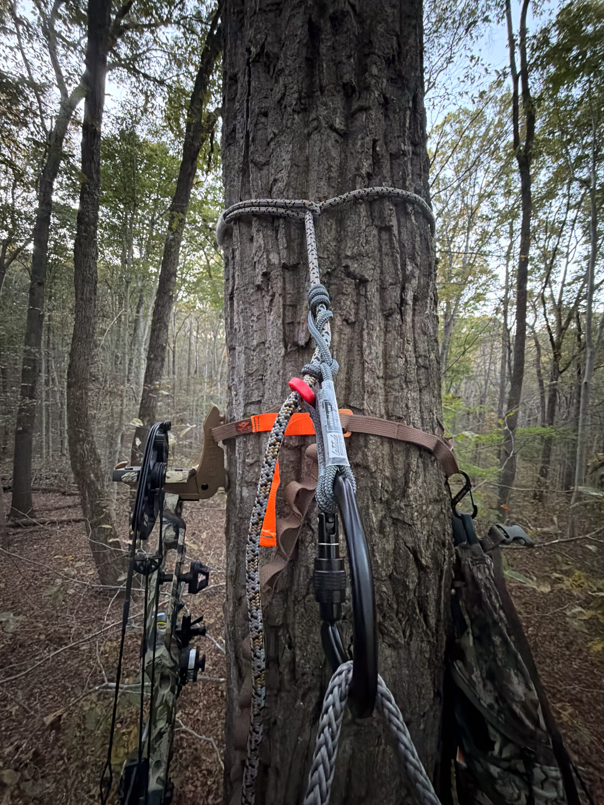

I'm a member of a deer management archery program. Among its requirements: archery only, and shots must be taken from at least 10 feet off the ground. That means figuring out how to get myself and my gear into a tree.

I'm not a huge fan of ladder stands. I prefer the mobility of saddle hunting, especially somewhere that's new to me. Scouting is limited in this program, and without much time to scout before the season, it's hard to know where I should set up. I want the flexibility to choose a suitable tree once I have a better idea of where I need to be.

There's also the cost. With a saddle, I'm paying for one setup that I can take wherever I hunt.

Here's what I'm using, what I like about it, and what I'm still figuring out. The bow and my homemade arrows deserve posts of their own.

## The saddle and storage pockets

My saddle is the **[Tethrd Phantom XP](https://tethrd.com/products/phantom-xp-saddle)**, and I love it. So far, I have zero complaints about the saddle itself. I also have **[Tethrd knee pads](https://tethrd.com/products/knee-pads)**, which stay in my pack with the saddle until I get to my tree.

Where I'm still experimenting is how to hang and organize everything around me. I have a **[Tethrd SYS Hauler ES2.0](https://tethrd.com/products/sys-hauler-es-2-0) pocket on each side**, one for my lineman's rope and one for my tether.

I have two small complaints about the pockets. First, the drawstring closures make getting the ropes back in a little fiddly. Second, the smaller pockets on the outside aren't deep enough to securely hold my HYS strap or the platform's cam buckle and strap. I've started putting those in the main pockets, underneath the ropes. That works, but I'm still playing with where everything belongs.

## Why I chose the Latitude ropes

I use the **Latitude 8mm Vapor Line [lineman's belt](https://www.latitudeoutdoors.com/products/vapor-line-8mm-lineman-belt) and [tree tether](https://www.latitudeoutdoors.com/products/vapor-line-8mm-tether)**. The feature that sold me on them was the included prusik tender.

A prusik is a friction hitch used to adjust the rope system. The tender helps move that hitch along the rope with one hand. That one-handed adjustment is the convenience I wanted from a mechanical rope grab, while keeping the prusik as the gripping component. Latitude supplies both the lineman's belt and tree tether configured for single-handed operation.

For me, the appeal is avoiding an additional mechanical device, along with the extra metal that could make noise or add weight. It was a specific reason to choose these ropes over the other options I was considering.

## The Predator V platform

The **[Tethrd Predator V](https://tethrd.com/products/predator-v)** is a little small for my liking once I'm up in the tree. I'd prefer more room underfoot.

On the walk in, though, that size is useful. It fits inside my **[First Lite Transfer pack](https://firstlite.com/products/transfer-pack)**, and I'm not sure how I'd fit a larger platform in there with everything else. So there's a tradeoff: I'd like a larger platform during the sit, but I appreciate being able to pack this one away.

It's also a little loud and needs [Stealth Strips](https://www.stealthoutdoors.com/store/stealth-strips-roll/) to quiet it down.

Once attached, it's been pretty stable, though that has depended on the tree's bark. I've never had it kick out, but it has moved a little. That's been my experience so far, and it's something I pay attention to when getting settled.

## The Carbon Synergy climbing sticks

**Safety update, November 3, 2026:** Latitude issued a [stop-use notice for all Carbon Synergy climbing sticks](https://www.latitudeoutdoors.com/pages/carbon-synergy-notice) on November 2 after reports of steps slipping or detaching from the posts. The company instructs owners to stop using them immediately and offers a full refund regardless of where they were purchased. The observations below describe my experience before this notice.

My **[Latitude Carbon Synergy climbing sticks](https://www.latitudeoutdoors.com/pages/carbon-synergy-notice)** have been great to climb with. They're extremely light, feel sturdy, and have plenty of grip.

One of my favorite things about them is the sound. If they knock into something, the carbon construction gives them more of a rattling-antler sound. They don't have that metal twang.

Getting them attached to the tree is easy. Getting the attachment cord loose during teardown is harder. I haven't quite figured out the trick to that part yet.

I either carry the sticks by hand or strap them underneath the Transfer pack. The pack has MOLLE-like webbing on the bottom, so I rigged up straps using **one-inch webbing, tri-glides, and G-hooks**. That gives me a way to carry the sticks on the pack when I want my hands free.

### Carrying the sticks up the tree

For carrying the sticks while climbing, I borrowed an idea from Latitude. I tied a piece of 550 paracord to a loop of MOLLE webbing on my saddle using a double anchor knot. At the other end, I made a loop with a slip knot. That loop slips over the end of a step, letting the stack of sticks hang from the saddle.

This has worked well, but the sticks swing freely. I like that they generally hang clear of my other gear. The downside is that they can make noise if they swing into something. I'd like them to hang a little tighter to me so they don't move around as much.

The next variation I want to try is tying a loop around one of the sticks and clipping it to an S-biner that lives on my saddle. I haven't tested that arrangement yet, but I want to see whether it keeps the stack closer and cuts down on the swinging.

## Hanging the bow

I use the **[Tethrd HYS strap](https://tethrd.com/products/hys-strap)** with the **[Tethrd Fold N Go](https://tethrd.com/products/fold-n-go)** to hold my bow once I'm in the tree. It's another part of the setup that packs away for the walk in, with the HYS strap currently living underneath a rope in one of the SYS Haulers.

## Why I carry the Transfer pack

The **[First Lite Transfer](https://firstlite.com/products/transfer-pack)** is a little big and heavy. It's probably more pack than many people would carry for this kind of hunt, but it works well for how I want to enter these parks.

I want to look as inconspicuous as possible. For me, that means everything goes in or on the pack. I strap my bow to it, keep my midlayers and insulation inside, and pack the saddle and knee pads instead of wearing them on the walk in. Those go on when I reach my tree.

Along with the hunting setup, I carry:

- A tourniquet and small first aid kit
- Extra 550 paracord and a carabiner
- A kill kit
- Snacks and a [Nalgene](https://nalgene.com/product-category/bottles/) for all-day sits

Between that gear, the platform, and the clothing, the space gets used. The pack's size makes more sense when you consider that it's carrying the saddle and layers as well as the things I need during the hunt.

## What I am still adjusting

The saddle itself has been great. The things I'm still working on are mostly about packing, organization, and teardown: where the straps belong, how to make repacking the ropes less fiddly, and how to release the sticks' attachment cords more easily. The platform needs quieting down, and I'd still like more room to stand.

For now, this setup gives me the mobility I wanted. I can carry everything to my tree, get set up there, and take the same equipment with me when I need to hunt somewhere else.
